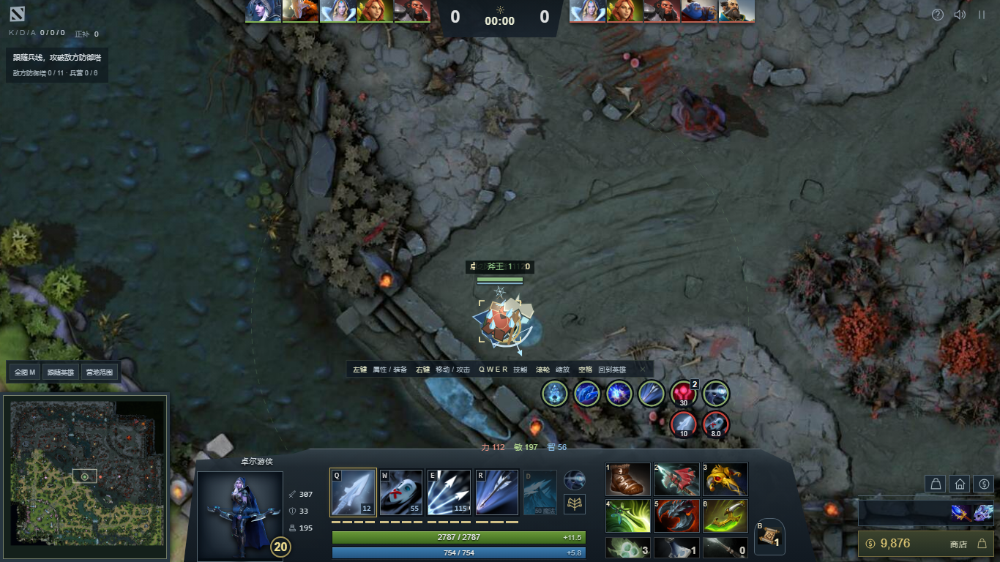
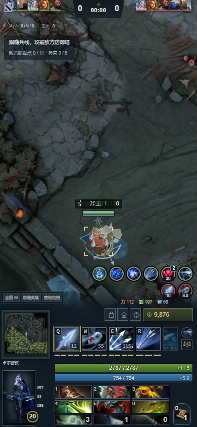

# 2026-11-07 HUD 与状态栏验收

## 本次改变

大厅采用深色英雄预览布局、本地 Valve 技能图标及紧凑选人区域。默认战斗 HUD 调整上方十名英雄头像和比分、左下小地图、中央英雄头像/等级/经验/技能/生命/魔法、3×2 六格装备、三格背包、独立 TP、右下快捷购买与信使。保留原有加点、天赋、购买、拖放、单位检查、单机存档和联机入口。

状态栏完整读取显式增益/减益，并补上实际已生效的光环、射手天赋、守卫/区域、永久效果、建筑与装备状态。奥术光环、射手天赋与战斗计算共用查询函数；物品光环在同一次属性刷新中提供显示来源。正/负状态分排、原始技能/物品图标、计时环、层数及说明均接入实际模拟时间。

## 验证

在本地原生服务器 `http://localhost:5186` 验证最终代码；截图位于忽略构建目录 `artifacts/`，精选截图保存在本记录的 `hud-images/`。

HUD 截图使用固定测试场景：通过现有 `addStatus` 接口和英雄/装备状态构造同时存在的增益、减益、升级和物品格。它们用于检查渲染与移除条件，规则集成测试另外检查实际施法、范围、失效与快照传输。截图没有与原客户端做像素差分。

| 检查 | 结果 |
| --- | --- |
| `npm test` | 413 项：412 通过，1 项按原配置跳过，0 失败 |
| `node tests/status-runtime.test.mjs` | 9 项集成：光环学习/近远/源死亡，射手天赋近身/破坏/冰川，物品禁用/背包，辉耀，永久层数，守卫，渐隐，驱散，暂停/过期，快照和建筑保护 |
| `npm run test:hud` | 5 组 Playwright 检查；1920×1080、1366×768、390×844；格数与几何、图标/层数/说明、节点保留、状态出现/消失、商店与检查面板 |
| `npm run test:browser` | 17 项既有浏览器回归检查通过 |
| `node tests/browser-shop.mjs` | 8 项目录/购买/退款/背包/储藏/神秘商店/快捷购买/响应式检查通过 |
| `npm run test:drow` | 8 组、9 个实际效果场景通过 |
| `npm run build` / `npm run check:build` | 静态构建与模块/本地引用检查通过 |
| `git diff --check` | 通过 |

新增 HUD 浏览器检查接入 `docker.yml`，发布工作流会对提交运行相同检查。

界面来源、两项替代图标及原版 1:1 尚缺的对照详见 [HUD/状态栏来源](../hud-status-sources.md)。本次通过的测试证明当前工程行为，不证明与 Dota 2 客户端完全等价。
